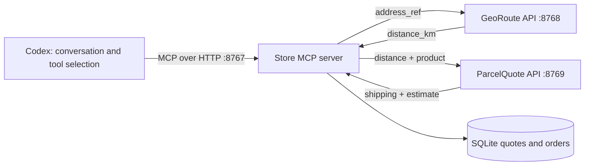

# Show MCP in action: Maya shops through a local Codex plugin

This is the **runnable local plugin**, separate from the marketplace sample packages that contain `.example` URLs. The existing plugin is `trailshop-local@docsalot-mcp-workshop`, displayed as **Trailshop Local Demo**.

## Before the call

From the repository root:

```sh
uv run python store/codex-demo/manage.py start
uv run python store/codex-demo/manage.py status
uv run python store/codex-demo/validate.py --transactions
```

`start` is safe to repeat. `status` should show `running: true`. Validation should end with `PASS: local HTTP demo works. No real purchase or payment occurred.` It creates and cancels one fictional order, checks a same-key retry, prevents quote reuse, and rejects other-customer/dispatched orders.

The plugin is already installed on Faizan's laptop. Verify it with:

```sh
codex plugin list --marketplace docsalot-mcp-workshop --json
```

Expect `installed: true` and `enabled: true`. Open a **fresh local Codex chat** so it can load the plugin, and select Trailshop Local Demo if a plugin picker is available. If the desktop chat does not expose the locally installed tools, launch a fresh local Codex CLI session from this repository with `codex`. Do not use a cloud task for this loopback demo.

For someone installing the workshop on another computer, the one-time setup is in [README.md](README.md). They need the local server running too; installing a plugin does not start this Python process.

## The picture to explain



“I’m using Codex as the AI host. The plugin tells it where my store’s MCP server lives. The server describes what it can do. Codex chooses a tool, calls it, and uses the result in the conversation. Behind that MCP interface, the store still calls normal APIs.”

## 1. Show the plugin connection

Open [plugin/.mcp.json](plugin/.mcp.json):

```json
{
  "mcpServers": {
    "trailshop-local": {
      "type": "http",
      "url": "http://127.0.0.1:8767/mcp"
    }
  }
}
```

“This is the actual connection. It is local HTTP. HTTPS is not needed for this local Codex demo. The plugin manifest points to this file; the Python server runs separately.”

Open [plugin/.codex-plugin/plugin.json](plugin/.codex-plugin/plugin.json). Point out `mcpServers: "./.mcp.json"`, the display name and the starter prompt. No API key or OAuth secret is in the plugin.

## 2. Show how one Python function becomes a tool

Open [server.py](server.py), at `search_products` (line 58 in the current source):

```python
@mcp.tool(title="Search store products", annotations=READ)
def search_products(color: str = "blue") -> dict:
    """Return one in-stock blue carry-on fixture, or an honest no-match."""
```

“This decorator registers a tool. The function name identifies it, the docstring describes its purpose, and the typed arguments become the input schema. The SDK handles MCP discovery, invocation and result serialization. I haven’t written an OpenAI function wrapper in this server.”

At the bottom of `server.py`, show the actual transport:

```python
mcp.run(transport="streamable-http", host="127.0.0.1", port=PORT)
```

“Codex discovers the tool menu through MCP. For this example, it can search, quote, place an order, read an order, and cancel one. The model proposes a tool call; the host and server execute the operation.”

## 3. Ask Maya's question — search and quote only

Paste this in the fresh Codex conversation:

> Use the Trailshop Local Demo tools. Find me a blue carry-on backpack under $100 total, delivered by Friday to my saved demo-home address. Show the quote and wait for my confirmation before ordering.

Approve the requested demo tool calls if Codex asks. Expand the tool-call details to show the actual inputs and outputs.

Expected calls:

```json
{"color": "blue"}
```

→ `search_products`

```json
{"product_id": "blue-carryon", "address_ref": "demo-home"}
```

→ `quote_delivery`

Expected result: **$79 item + $12 delivery = $91 USD**, tax included, a **12 km** route and **Friday (fixture estimate)**. A generated `q_…` quote ID expires after **120 seconds**.

“I asked one question, but the quote function uses two providers. It resolves the saved destination through GeoRoute, then sends the route distance to ParcelQuote. It returns the small set of facts the model needs to answer me.”

Open `quote_delivery` in [server.py](server.py), line 84. Point to the two actual `http.post` calls, then the compact result at line 114. [providers.py](providers.py) supplies the two separate loopback HTTP endpoints. The networking is real; the product, distance, price and delivery estimate are fictional fixtures.

Do not stop to explain every line while the quote expires. Either show this code before asking for the quote, or ask Codex for a fresh quote before the next step.

## 4. Confirm the simulated purchase

Send:

> Yes, place that simulated order.

Expected tool: `place_order`, with the current quote ID, `confirmed: true` and a new idempotency key. Let Codex use the live returned ID. Any IDs or key examples in slides are illustrations, not values to reuse for another order.

Expected result: a generated `order_…` ID, `status: "placed"`, `total_cents: 9100`, and `payment: "simulated; no charge"`.

Open `place_order` in [server.py](server.py), line 131:

- It checks confirmation and the customer-bound, unexpired quote.
- The same key and quote return the stored result on retry.
- A different quote with the same key conflicts; a consumed quote cannot create another order with a new key.
- It stores the order and operation result together in SQLite.

“The interesting part is that a conversation has caused a checked state change. The model has not directly edited the database. Our tool applies the rules, and the server returns the authoritative outcome.”

## 5. Read, cancel and read again

Send these as separate turns:

> Show me the status of that order.

> Cancel that simulated order.

> Check its status again.

Confirm the cancellation if the host asks. Expected tools: `get_order` → `cancel_order` → `get_order`. Expected final state: **cancelled**.

Open `get_order` at line 187 and `cancel_order` at line 199 in [server.py](server.py).

“I can continue the same conversation. The order ID links these turns to persisted state. Cancellation checks who owns the order and whether it has dispatched, then records the new state. Cancelling does not prove a refund occurred; this demo does not simulate payment reversal.”

## 6. Optional: demonstrate one honest failure

> Try to cancel demo-shipped. Show me the tool's response; do not invent a successful cancellation.

Expected outcome: `ALREADY_DISPATCHED`, followed by the supported next step. Another fixture, `demo-other`, belongs to another fictional customer and returns `No accessible order`.

“The useful behavior includes saying no. MCP carries the request and result; our store implementation decides which operations are valid.”

## What each script does

| File | Role |
|---|---|
| `server.py` | Five MCP tools, two resources, one prompt; quote/order storage and business checks |
| `providers.py` | GeoRoute and ParcelQuote fixture HTTP APIs, running in separate listener threads |
| `manage.py` | Starts, checks and stops the detached local process; checks ports and keeps its PID/log location |
| `validate.py` | An MCP client that checks the running HTTP server without an LLM; optional simulated transactions |
| `demo.py` | Starts the combined demo on temporary ports and a temporary database, validates it, then shuts it down |

The resources are `trailshop://policies/returns` and `trailshop://guides/carry-on`; the prompt is `shop_for_maya`. Validation exercises them. Host interfaces expose resources/prompts differently, so the five tools are the reliable core of this presentation.

## Locations and troubleshooting

- Source: `store/codex-demo/` in this repository.
- Installed plugin cache on this laptop: `/Users/faizank/.codex/plugins/cache/docsalot-mcp-workshop/trailshop-local/1.0.0/`.
- Server: `http://127.0.0.1:8767/mcp`.
- Provider APIs: `http://127.0.0.1:8768/route` and `http://127.0.0.1:8769/quote`.
- State/logs: `/Users/faizank/.local/state/trailshop-codex/` (`store.sqlite3`, `server.log`, `process.json`).

| Symptom | Next step |
|---|---|
| Tools are missing | Check plugin installed/enabled, server status, then use a fresh local Codex session |
| QUOTE_EXPIRED | Ask for a fresh quote and confirm promptly |
| IDEMPOTENCY_CONFLICT | Use a fresh key for a new order; reuse a key only for retrying the same quote |
| Connection refused | Run `manage.py start`; inspect `server.log` if startup fails |
| `/mcp` shows 400/405/406 in a browser | Use the MCP validator; opening the endpoint in an address bar is not a valid tool call |
| Local server is unreachable from a cloud task | Run the demo locally. HTTPS alone does not make your laptop's loopback address reachable remotely |

No real purchases, payments or addresses are used. Maya's identity is fixed in `customer()` and `require_write()` is a no-op in this loopback fixture. The ownership/state checks are concrete; production authentication and independent proof of user consent are separate work. For a hosted marketplace connection, deploy a reachable service with the required authentication and trusted HTTPS; the local demo's HTTP success does not establish public-submission readiness.

To stop after the call:

```sh
uv run python store/codex-demo/manage.py stop
```

Leave the process running during the call. Restarting preserves the existing orders.
